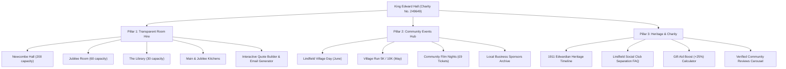

# King Edward Hall — Redesign & Modern Web Platform

[](https://terrykell-byte.github.io/king-edward-hall-website/)
[](https://www.kingedwardhall.org.uk/)
[](https://github.com/terrykell-byte/king-edward-hall-website/actions)

Modern, accessible, mobile-first web platform and interactive venue hire engine for **King Edward Hall**, an iconic 1911 Edwardian landmark situated in the heart of Lindfield, West Sussex (opposite the village duck pond).

---

## 🌐 Live Website & Mobile Preview

* **Public Web & Mobile URL**: [https://terrykell-byte.github.io/king-edward-hall-website/](https://terrykell-byte.github.io/king-edward-hall-website/)
* **GitHub Repository**: [terrykell-byte/king-edward-hall-website](https://github.com/terrykell-byte/king-edward-hall-website)
* **Default Branch**: `main` (auto-deploys via GitHub Actions)

---

## 🏛️ The Three Pillars Architecture

The redesign resolves the historical identity tension between room hire commercial operations, village tradition stewardship, and charitable heritage:



---

## 🚀 Key Features

### 1. Instant Pricing Engine & Booking Inquiries
- **Interactive Quote Calculator**: Live calculation based on room capacity, duration, day of week, and time of day.
- **Accurate Rate Logic**: Automatically applies weekend peak rates (£38/hr Newcombe, £24/hr Jubilee, £18/hr Library) for Friday evenings ($\ge$ 18:00) and all-day Saturday/Sunday; weekday rates apply Monday–Friday daytime.
- **Add-on Facilities**: Main catering kitchen (£25/session), Jubilee Kitchen (£15/session), PA sound system with induction hearing loop (£20), and AV multimedia projector (£15).
- **Automated Mailto Inquiry Generator**: Instant pre-filled booking draft formatted directly for the Hall Booking Secretary with exact quote breakdown, requested date/time, and client details.

### 2. Village Events Hub & Live Countdowns
- **Lindfield Village Day (05/06/2027)**: 49th annual village celebration info, parade overview, and interactive stallholder inquiry submission.
- **Lindfield Village Run (23/05/2027)**: 5K & 10K road/cross-country event details with interactive runner registration form and live countdown ticker.
- **Film Nights Cinema**: Monthly village screenings in Newcombe Hall with ticket reservation builder and licensed bar details.
- **Community Sponsors**: Transparent recognition of local High Street partners and King Edward Hall sponsors.

### 3. Edwardian Heritage & Charitable Trust
- **1911 Timeline**: Interactive archival journey from the 1910 building committee and opening ceremony to mid-century modernization and present-day stewardship.
- **Lindfield Club Separation FAQ**: Clear delineation explaining that the first-floor Lindfield Club (with private snooker tables and member bar) is legally and operationally distinct from King Edward Hall Charitable Trust.
- **Gift Aid Donation Calculator**: Demonstrates the real-world value of charitable donations, automatically computing the 25% HMRC Gift Aid uplift.
- **Community Reviews**: Filterable review carousel featuring verified Lindfield wedding couples, party organizers, theater attendees, and regular class instructors.

---

## 🛠️ Technology Stack & Engineering Standards

- **Core**: React 19, TypeScript 5.7, Vite 6
- **Styling**: Tailwind CSS 3 with custom heritage design system (`brand-forest`, `brand-brass`, `brand-cream`)
- **Icons**: Lucide React
- **Testing**: Vitest 3 with comprehensive domain seam test coverage
- **CI/CD**: GitHub Actions automated workflow deploying to GitHub Pages
- **Engineering Standards**: Developed following Matt Pocock's agentic engineering skills (TDD on pricing seams, tracer-bullet ticketing under `.scratch/`, domain glossary compliance).

---

## 💻 Local Development Setup

```bash
# Clone the repository
git clone https://github.com/terrykell-byte/king-edward-hall-website.git
cd king-edward-hall-website

# Install dependencies
npm install

# Start local development server
npm run dev

# Run Vitest test suite
npm test

# Build production bundle
npm run build

# Preview production build locally
npm run preview
```

---

## 📂 Project Structure

```
king-edward-hall-website/
├── .github/workflows/deploy.yml   # GitHub Pages automated deployment
├── .scratch/website-redesign/     # Tracer-bullet tickets & spec
│   ├── spec.md                    # Formal redesign specification
│   └── issues/                    # KEH-001 through KEH-007 tickets
├── docs/                          # Architecture & agent docs
│   ├── wiki/                      # Complete system documentation
│   └── agents/                    # Domain, issue-tracker, triage standards
├── src/
│   ├── components/                # React UI components
│   │   ├── Header.tsx             # 3-pillar navigation & mobile drawer
│   │   ├── Footer.tsx             # Charity registration, pillars, links
│   │   ├── BookingCalculator.tsx  # Quote builder & inquiry generator
│   │   ├── RoomShowcases.tsx      # Room details, comparison, doc modal
│   │   ├── EventHubs.tsx          # Village Day, Run, Film Nights, Sponsors
│   │   └── AboutAndCharity.tsx    # 1911 timeline, FAQ, Gift Aid, reviews
│   ├── domain/                    # Pure business logic & seam tests
│   │   ├── pricing.ts             # Pricing engine, rules, rates
│   │   └── __tests__/pricing.test.ts # Vitest unit tests (8 tests)
│   ├── App.tsx                    # Root routing & layout container
│   ├── main.tsx                   # React root entry point
│   └── index.css                  # Tailwind styles & theme variables
├── AGENTS.md                      # Agent rules & skills index
├── GLOSSARY.md                    # Canonical domain glossary
└── package.json
```

---

## 📄 License & Charity Information

Operated and maintained for the benefit of the Lindfield community by the **King Edward Hall Charitable Trust** (Registered Charity No. 249649).
24 High Street, Lindfield, West Sussex RH16 2HH.
