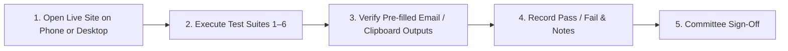

# User Acceptance Testing (UAT) Plan — King Edward Hall Website

> **Live UAT Environment**: [https://terrykell-byte.github.io/king-edward-hall-website/](https://terrykell-byte.github.io/king-edward-hall-website/)  
> **Organization**: King Edward Hall Charitable Trust (Registered Charity No. 249649)  
> **Target Audience**: Trustees, Management Committee, Booking Administrator, Event Committees, and Village Residents

---

## 1. Purpose & Scope

This User Acceptance Testing (UAT) plan provides a step-by-step script for non-technical end users and committee members to verify that the redesigned King Edward Hall website meets real-world operational needs before retiring the legacy WordPress site.

> [!TIP]
> **Testing on Both Desktop & Mobile**: We recommend having at least two testers run through this checklist on a **smartphone** (iPhone Safari or Android Chrome) and two testers on a **desktop/laptop** browser.

### Key Testing Personas

| Persona | Representative Tester(s) | Primary Focus Areas |
| :--- | :--- | :--- |
| **Hall Hirer & Booking Admin** | Tracy Ely (Room Hire Admin) & Sample Hirer | Room rates, peak/weekday calculation, capacity warnings, kitchen add-ons, and inquiry email formatting |
| **Village Events Coordinator** | Village Day & Village Run Committee Members | Event dates (`23/05/2027` & `05/06/2027`), countdowns, stallholder inquiries, runner entries, and Film Nights tickets |
| **Trustee & Village Donor** | William Blunden, Nikki Smith, Trustees | 1911 heritage timeline, Charity No. 249649 details, Gift Aid (+25%) calculation, and Lindfield Club FAQ distinction |

---

## 2. UAT Workflow Overview

---

## 3. UAT Test Suites & Checklists

### Suite 1: Home Page, Photo Slide Deck & Navigation

| ID | Test Scenario | Steps to Perform | Expected Result | Status (Pass/Fail) |
| :--- | :--- | :--- | :--- | :--- |
| **UAT-NAV-01** | **Front-Page Photo Slide Deck** | 1. Open the home page. 2. Watch the photo carousel on the right. 3. Click the **Pause/Play** button, **Next/Prev** arrows, and a thumbnail at the bottom. 4. Click the brass button inside a slide (e.g., *"Explore Village Day"*). | Slides glide smoothly every ~4.2 seconds, pause when toggled, jump to the selected thumbnail when clicked, and navigate to the matching page when the slide button is clicked. | [ ] |
| **UAT-NAV-02** | **Desktop Three-Pillar Dropdowns** | On a desktop/laptop, hover over (or press `Tab` to focus) **Room Hire & Facilities**, **Community Events**, and **The Hall & Charity** in the top navigation bar. Press `Escape`. | Each dropdown menu opens cleanly showing sub-pages and badges, and closes when moving away or pressing `Escape`. | [ ] |
| **UAT-NAV-03** | **Mobile Hamburger Drawer** | On a mobile phone (or narrow browser window), tap the top-right **Menu (☰)** button, scroll through the drawer, and tap any link. | The menu opens smoothly over a dimmed backdrop, background scrolling is locked while open, and tapping a link navigates to that section and closes the drawer. | [ ] |
| **UAT-NAV-04** | **Browser Back / Forward & Direct Links** | Navigate from **Home** → **Newcombe Hall** → **Village Day**, then press the browser **Back** button twice. | The URL hash updates (`#room-newcombe`, `#event-village-day`) and the browser Back button returns to the previous views accurately. | [ ] |

---

### Suite 2: Room & Kitchen Showcases & Interactive Floor Plans

| ID | Test Scenario | Steps to Perform | Expected Result | Status (Pass/Fail) |
| :--- | :--- | :--- | :--- | :--- |
| **UAT-ROOM-01** | **Room Hire Overview & Tariff Table** | Navigate to **Room Hire & Facilities → Overview & All Rooms** (`#room-hire`). Inspect the 3 room cards, 2 kitchen cards, and the 2026/2027 Hire Charges table. | Rates match official tariff: • **Newcombe Hall**: £28 weekday / £38 weekend (200 max) • **Jubilee Room**: £18 weekday / £24 weekend (60 max) • **The Library**: £14 weekday / £18 weekend (30 max) • **Main Kitchen**: +£25 flat fee • **Jubilee Kitchen**: +£15 flat fee | [ ] |
| **UAT-ROOM-02** | **Seating Configuration Switcher** | 1. Open **Newcombe Hall** (`#room-newcombe`). 2. Click through **Theatre / Concert**, **Wedding / Banquet**, and **Exhibition / Fair** buttons. 3. Observe the guest capacity badge and the schematic preview on the right. | The capacity badge updates (`200`, `100`, `150` guests) and the SVG architectural schematic dynamically changes between rows, banquet tables with dancefloor, and open floor. | [ ] |
| **UAT-ROOM-03** | **Newcombe Hall Photo Switcher** | On the **Newcombe Hall** page, click the two photo thumbnails below the main photograph (*"Newcombe Hall & Stage"* and *"Wedding & Banquet Setup"*). | The main room photograph and caption switch cleanly between the stage view and wedding setup. | [ ] |
| **UAT-ROOM-04** | **Interactive Floor Plan & Print Modal** | 1. On any room detail page, click **"Interactive Floor Plan & Specs"** (or **"Enlarge Plan →"**). 2. Switch layouts inside the popup. 3. Click **"Print / Save PDF Specification"**. 4. Close the modal using `Escape` or **Close**. | A modal dialog opens showing the blueprint schematic and premises safety rules (23:30 PM music curfew, TEN alcohol rule). Clicking Print opens the browser print/PDF dialog. | [ ] |
| **UAT-ROOM-05** | **Kitchen Pre-Selection Shortcut** | 1. Navigate to **Main & Jubilee Kitchens** (`#kitchens`). 2. Click **"Book Jubilee Room + Jubilee Kitchen →"** on the Jubilee Kitchen card. | Opens the **Interactive Price Calculator** with **Jubilee Room** selected in Step 1 and **Jubilee Kitchen (+£15)** automatically selected in Step 2. | [ ] |

---

### Suite 3: Interactive Pricing Calculator & Booking Inquiry Flow

| ID | Test Scenario | Steps to Perform | Expected Result | Status (Pass/Fail) |
| :--- | :--- | :--- | :--- | :--- |
| **UAT-CALC-01** | **Standard Weekday Off-Peak Calculation** | 1. Open the **Price Calculator** (`#calculator`). 2. Select **Newcombe Hall**. 3. Pick a **Wednesday** date, Start Time `10:00`, Duration `4 Hours`, **No Kitchen Required**, no equipment. | Badge below Date shows **"Standard Off-Peak Weekday"**. Hourly rate is **£28/hr**, and Estimated Hire Fee is **£112** (`4 × £28`). | [ ] |
| **UAT-CALC-02** | **Friday Daytime vs. Friday Evening Peak Rule** | 1. With **Newcombe Hall** selected, pick a **Friday** date. 2. Set Start Time to `14:00` and Duration to `3 Hours` (ends `17:00`). 3. Change Start Time to `16:00` and Duration to `4 Hours` (extends to `20:00`). 4. Change Start Time to `19:00`. | • `14:00` for `3h` (ends `17:00`): **Standard Off-Peak Weekday** (£28/hr = £84). • `16:00` for `4h` (extends past `18:00`) and `19:00`: Automatically switches to **Peak Rate (Weekend / Fri Eve)** (£38/hr = £152). | [ ] |
| **UAT-CALC-03** | **Weekend + Kitchen + Equipment Add-ons** | 1. Select **Newcombe Hall** on a **Saturday** for `5 Hours` (`£190`). 2. Select **Main Kitchen (+£25)** in Step 2. 3. Select **PA Sound System (+£20)** and **HD Digital Projector (+£15)** in Step 3. | Live breakdown card shows: • Base Room Fee: **£190** • Kitchen Fee: **£25** • Equipment Fee: **£35** • Estimated Hire Fee: **£250** | [ ] |
| **UAT-CALC-04** | **Room Capacity Guardrail Warning** | 1. Select **The Library** (30 max seated) in Step 1. 2. Set **Expected Guests** to `50` using the `+` button or typing `50`. | An amber warning banner appears: *"Expected guests (50) exceeds The Library maximum seated capacity (30). Please consider hiring a larger hall or reducing attendance."* | [ ] |
| **UAT-CALC-05** | **Form Validation Guardrails** | Leave Name, Email, Phone, or Event Description blank and click **"Submit Provisional Inquiry"**. | Form prevents submission and displays clear validation messages indicating which required fields are missing. | [ ] |
| **UAT-CALC-06** | **Inquiry Confirmation, Email Client & Clipboard Copy** | 1. Check the **"Recurring Booking"** box. 2. Fill in Name, Email, Phone, and Event Description. 3. Click **"Submit Provisional Inquiry"**. 4. Click **"Copy Inquiry to Clipboard"** and paste into a notes app. 5. Click **"Open in Email Client"**. | • Confirmation screen displays the full booking summary. • **"Copied to Clipboard!"** appears and pasting shows a structured summary addressed to Tracy including Room, Date, Time, **Attendees**, Kitchen, Equipment, Estimated Total, and Contact details. • **"Open in Email Client"** opens an email addressed to `roomhire@kingedwardhall.org.uk`. | [ ] |

---

### Suite 4: Community Event Hubs (Village Day, Village Run, Film Nights, Sponsors)

| ID | Test Scenario | Steps to Perform | Expected Result | Status (Pass/Fail) |
| :--- | :--- | :--- | :--- | :--- |
| **UAT-EVT-01** | **Lindfield Village Day & Stallholder Form** | 1. Go to **Community Events → Lindfield Village Day** (`#event-village-day`). 2. Verify the event date (`05/06/2027`), schedule (`12:00 PM`, `1:00 PM`, `5:00 PM`), and countdown. 3. Enter a business name, select a stall category, and submit. 4. Click **"Send Email to Village Day Team"**. | Confirmation box appears and clicking the button opens a pre-filled email to `villageday@kingedwardhall.org.uk` with the business name and stall category. | [ ] |
| **UAT-EVT-02** | **Lindfield Village Run & Race FAQs** | 1. Go to **Community Events → Lindfield Village Run** (`#event-village-run`). 2. Verify race date (`Sunday 23/05/2027`), start times (`10:30 AM` 10K, `10:45 AM` 5K), and prices (`£10` / `£20`). 3. Click each FAQ question on the right. 4. Fill in the Runner Pre-Registration form and submit. | • FAQ accordions expand and collapse cleanly (mentioning Hickmans Lane, cross-country terrain, headphone ban, and water stations). • Submitting registration shows confirmation with a pre-filled email button to `run@kingedwardhall.org.uk`. | [ ] |
| **UAT-EVT-03** | **Film Nights Screening Selection & Ticket Counter** | 1. Go to **Community Events → Film Nights Cinema** (`#event-film-nights`). 2. Click on the **"Pressure"** film card on the left. 3. Select `4` tickets under **Number of Tickets**. 4. Click **"Confirm Ticket Reservation"**. | • Clicking the *"Pressure"* card highlights it as **Selected** and updates the dropdown on the right. • Total due calculates as **£36.00** (`£9 × 4`). • Confirming provides a pre-filled email link to `secretary@kingedwardhall.org.uk`. | [ ] |
| **UAT-EVT-04** | **Community Event Sponsors** | Go to **Community Events → Community Sponsors** (`#event-sponsors`) and click **"Inquire About Business Sponsorship"**. | Displays the 8 local sponsor cards and opens a pre-filled sponsorship email to `villageday@kingedwardhall.org.uk`. | [ ] |

---

### Suite 5: Charity, 1911 Heritage, Gift Aid & Lindfield Club FAQ

| ID | Test Scenario | Steps to Perform | Expected Result | Status (Pass/Fail) |
| :--- | :--- | :--- | :--- | :--- |
| **UAT-CHAR-01** | **Testimonials Category Filter & Carousel** | 1. Go to **The Hall & Charity → About King Edward Hall** (`#about`). 2. Click the filter pills (**all**, **wedding**, **party**, **cinema**) and use the `<` / `>` arrows. | Reviews filter by event type and cycle through verified hirer quotes with 5-star ratings. | [ ] |
| **UAT-CHAR-02** | **1911 Heritage Timeline** | Go to **The Hall & Charity → 1911 History & Heritage** (`#history`). | Displays the chronological milestones: `11th January 1911`, `1914–1918 (WWI Red Cross Hospital)`, `1939–1945 (WWII)`, `1977 (Silver Jubilee Wing)`, and `2014–Present (Newcombe Hall)`. | [ ] |
| **UAT-CHAR-03** | **Gift Aid (+25%) Donation Calculator** | 1. Go to **Support Our Charity** (`#donate`). 2. Select **£50**. 3. Toggle **"Add Gift Aid (+25%)"** on and off. 4. Click **"Proceed With £50 Donation"**. | • With Gift Aid checked, total value to KEH shows **£62.50**; unchecked shows **£50.00**. • Confirmation provides a pre-filled email pledge link to `secretary@kingedwardhall.org.uk`. | [ ] |
| **UAT-CHAR-04** | **Lindfield Club Separation FAQ & Officer Directory** | 1. Go to **Facilities & Social Club FAQ** (`#faq`) and read the top amber card. 2. Go to **Contact & Trustees** (`#contact`). | • FAQ clearly distinguishes ground-floor **King Edward Hall Charitable Trust** from the first-floor private **Lindfield Club**. • Contact directory lists Tracy Ely, Nikki Smith, William Blunden, and trustees Simon Cartwright, Ian Sayers, and Mark White. | [ ] |

---

### Suite 6: Mobile Ergonomics & Accessibility

| ID | Test Scenario | Steps to Perform | Expected Result | Status (Pass/Fail) |
| :--- | :--- | :--- | :--- | :--- |
| **UAT-A11Y-01** | **Mobile Sticky Live-Quote Bar** | On a smartphone, open the **Price Calculator** (`#calculator`), change rooms/hours at the top of the page, and tap **"Review & Send"** on the bottom sticky bar. | The bottom sticky bar updates the live £ total immediately and tapping **"Review & Send"** scrolls smoothly down to Step 4 (Contact Details). | [ ] |
| **UAT-A11Y-02** | **Mobile Rate Cards vs. Desktop Table** | View **Our Rooms & Kitchens** (`#room-hire`) on a smartphone (`< 768px` width) vs. a desktop screen. | On mobile, rates display as clean stacked cards with touch buttons (no horizontal pinch/scroll required); on desktop, rates display as a 6-column comparison table. | [ ] |

---

## 4. UAT Issue Log & Sign-Off Sheet

If any test scenario fails or requires wording adjustments, record the details below:

| Test ID | Device & Browser (e.g. iPhone Safari / Windows Chrome) | Observation / Requested Change | Priority (High / Med / Low) |
| :--- | :--- | :--- | :--- |
| | | | |
| | | | |
| | | | |

### Committee Sign-Off

- **Tester Name & Role**: `________________________________________`
- **Date Tested**: `____________________`
- **Overall Outcome**: `[ ] Approved for Launch` / `[ ] Approved with Minor Edits`
